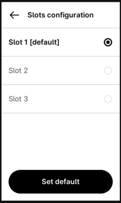

..
    Ledger App OpenPGP.
    (c) 2024 Ledger SAS.

   Licensed under the Apache License, Version 2.0 (the "License");
   you may not use this file except in compliance with the License.
   You may obtain a copy of the License at

       http://www.apache.org/licenses/LICENSE-2.0

   Unless required by applicable law or agreed to in writing, software
   distributed under the License is distributed on an "AS IS" BASIS,
   WITHOUT WARRANTIES OR CONDITIONS OF ANY KIND, either express or implied.
   See the License for the specific language governing permissions and
   limitations under the License.

..
   ------------------------------------------------------------------------
                         LaTex substitution Definition
   ------------------------------------------------------------------------

License
=======

  |  Ledger App OpenPGP.
  |  (c) 2024 Ledger SAS.
  |
  | Licensed under the Apache License, Version 2.0 (the "License");
  | you may not use this file except in compliance with the License.
  | You may obtain a copy of the License at
  |
  |     http://www.apache.org/licenses/LICENSE-2.0
  |
  | Unless required by applicable law or agreed to in writing, software
  | distributed under the License is distributed on an "AS IS" BASIS,
  | WITHOUT WARRANTIES OR CONDITIONS OF ANY KIND, either express or implied.
  | See the License for the specific language governing permissions and
  | limitations under the License.

Introduction
============

OpenPGP Card Application add-ons summary
----------------------------------------

Key management:
~~~~~~~~~~~~~~~

OpenPGP Application manage 4 keys to Perform Security Operation (PSO) plus 2 for secure channel.

The 4 keys are defined as follow:

- One asymmetric signature private key (RSA or EC), named 'sig'
- One asymmetric decryption private key (RSA or EC), named 'dec'
- One asymmetric authentication private key (RSA or EC), named 'aut'
- One symmetric decryption private key (AES), named 'sym0'

The 3 first asymmetric keys can be either randomly generated on-card or
explicitly imported from outside.

The 4th is imported from outside.

It's never possible to retrieve private key from the card.

This add-on specification propose a solution to derive those keys from the
master seed managed by the Ledger Token.
This allows owner to restore a broken token without the needs to keep track of keys
outside the card.

Moreover this add-on specification propose to manage multiple set of the 4 previously described keys.

Keys Slots
~~~~~~~~~~

To modify the keys slot, just select the corresponding menu from the screen.

*Nano*

*Wallet (Stax, Flex)*

Random number generation
~~~~~~~~~~~~~~~~~~~~~~~~

OpenPGP Application provides, as optional feature, to generate random bytes.

This add-on specification propose new type of random generation:

- random prime number generation
- seeded random number
- seeded prime number generation

Key Backup
~~~~~~~~~~

A full key backup mechanism is provided.

.. danger::
   **On-device data is wiped on every App or OS update.**

   The OpenPGP App stores all keys and metadata in its own non-volatile memory. Anything
   generated or imported on the device is erased whenever the App is reinstalled, which
   happens during any App update and during any OS update.

   The backup/restore mechanism described here (and the companion ``pytools`` script) is,
   today, the only available mitigation. It is **not trivial to operate and not guaranteed
   to work in every scenario** — private-key restore in particular only works when
   **SEED mode** was enabled when the backup was taken. It remains a procedure reserved
   to advanced users.

Ledger OpenPGP Application
==========================

How
---

Deterministic key derivation
~~~~~~~~~~~~~~~~~~~~~~~~~~~~

The deterministic key derivation process relies on the **BIP32** scheme.
The master install path of the App is set to ``/0x80'GPG'``, aka ``/80475047``.

Deterministic key derivation maybe activated in:

  | ``Settings -> Seed Mode -> Set on``

This activation remains effective until *set off* is selected.

The key management remains the same if seed mode is *on* or *off*. So there is no performance impact when using seeded keys.

Seeded keys are generated as follow:

**Step 1**:

For a given keys slot n, starting from 1, a seed is first derived with the following path

 | ``Sn = BIP32_derive (/0x80475047'/n')``

The last index is hardened, so that the seed of one slot gives no information on the other slots.

**Step 2**:

Then specific seeds are derived with the *SHAKE256* function for each key:

 | ``Sk[i] = SHAKE256(SHA256("kdf2" \| Sn \| <key_name> \| int16(i) \| int8(len(ctx)) \| ctx), length)``

Where:

- Sn is the dedicated slot seed from step 1.
- key_name is one of 'sig ','dec ', 'aut ', each 4 characters.
- i is the index, starting from 1, of the desired seed (see below)
- ctx is the algorithm with the key size: the first 3 bytes of the key attributes for RSA
  (algorithm and modulus size), the whole key attributes for ECC (algorithm and curve OID).
- length is the output length, in bytes.

**Step 3**:

*RSA key generation*

Generate two seed Sp, Sq in step2 with:

- i € {1,2}
- length equals to half key size

Generate two prime numbers p, q:

- set the two most significant bits of Sp and Sq
- p = next_prime(Sp)
- q = next_prime(Sq)

Generate RSA key pair as usual:

- choose e
- n = p*q
- d = inv(e) mod (p-1)(q-1)

*ECC key generation*

Generate one seed Sd in step2 with:

- i = 1
- length equals to twice the curve size

Generate ECC key pair:

- d = Sd mod curve order, on the curve size
- for Curve25519, d is clamped as in RFC 7748
- W = d.G

*Legacy derivation*

App versions up to 2.x derived the seeded keys differently, and this derivation is only kept
to restore their keys (see P2 of GENERATE ASYMMETRIC KEY PAIR):

- step 1 uses a non-hardened last index: ``Sn = BIP32_derive (/0x80475047'/n)``
- step 2 hashes neither "kdf2" nor ctx: ``SHA256(Sn | <key_name> | int16(i))``
- only the first length/8 bytes of the key buffer are derived:

  - for RSA, the rest of Sp and Sq is zero, and only their most significant bit is set
  - for ECC, the derivation is done over Sn, so d is these bytes followed by the rest of Sn,
    without reduction nor clamping

.. warning::

   A legacy RSA key can be factored from its public key alone, and the legacy ECC keys of a
   slot share most of their bytes. Keys restored with the legacy derivation should be replaced
   by newly generated ones.

*AES key generation*

Generate one seed Sd in step2 with:

- i = 1
- length equals to 16

Generate AES key:

- k = Sk

Deterministic random number
~~~~~~~~~~~~~~~~~~~~~~~~~~~

The deterministic random number generation relies on the **BIP32** scheme.
The master install path of the App is set to ``/0x80'GPG'``, aka ``/80475047``.

**Random prime number generation**:

For a given length *L*:

- generate random number r of *L* bytes.
- generate rp = next_prime(r)
- return rp

**Seeded random number**:

For a given length *L* and seed *S*:

- generate Sr = BIP32_derive(/0x80475047/0x0F0F0F0F)
- generate r = SHA3-XOF(SHA256(Sr \| 'rnd' \| S), L)
- return r

**Seeded prime number generation**:

For a given length *L* and seed *S*:

- generate r as for "Seeded random number"
- generate rp = next_prime(r)
- return rp

Key Backup & Restore
~~~~~~~~~~~~~~~~~~~~

In order to backup/restore private key the commands `put_data` and `get_data` accept the tags:

- `B6` (signature key)
- `B8` (encryption key)
- `A4` (authentication).

`put_data` command accept the exact output of `get_data`. The `get_data` command
return both the public and private key.

For security and confidentiality, the private key is returned encrypted with AES-GCM.
The 128-bit key is derived with the name 'key' from the seed of the slot, on the hardened path
of the seeded keys. Everything before the encrypted private key is authenticated with it: the
blob only restores on the same seed and slot, into the same key role and key attributes.

The data payload (format version 3) is formatted as follow:

  +-------+--------------------------------------------+
  | size  | Description                                |
  +=======+============================================+
  | 1     | format version: 03                         |
  +-------+--------------------------------------------+
  | 12    | GCM nonce                                  |
  +-------+--------------------------------------------+
  | 2     | key reference: B6, B8 or A4                |
  +-------+--------------------------------------------+
  | 1     | key attributes size                        |
  +-------+--------------------------------------------+
  | var   | key attributes                             |
  +-------+--------------------------------------------+
  | 4     | public key size                            |
  +-------+--------------------------------------------+
  | var   | public key                                 |
  +-------+--------------------------------------------+
  | 4     | encrypted private key size, with the tag   |
  +-------+--------------------------------------------+
  | var   | encrypted private key, then 16-byte tag    |
  +-------+--------------------------------------------+

`put_data` also accepts the formats of older app versions, which start with the OS Target ID and
the API Level, both ignored: version 2 (no key reference nor attributes, key derived on the
non-hardened slot path), version 1 (no nonce field, nonce built from the slot and the key
reference) and the AES-CBC format without version byte.

APDU Modification
-----------------

Key Slot management
~~~~~~~~~~~~~~~~~~~~

Key slots are managed by data object *01F1* and *01F2* witch are
manageable by PUT/GET DATA command as for others DO and organized as follow.

On application reset, the *01F2* content is set to *Default Slot* value
of *01F1*.

*01F1:*

  +-------+----------------------------------+-------+
  | bytes | Description                      | R/W   |
  +=======+==================================+=======+
  | 1     | Number of slot                   | R     |
  +-------+----------------------------------+-------+
  | 2     | Default slot                     | R/W   |
  +-------+----------------------------------+-------+
  | 3     | Allowed slot selection method    | R/W   |
  +-------+----------------------------------+-------+

Byte 3 is encoded as follow:

  +----+----+----+----+----+----+----+----+-------------------------+
  | b8 | b7 | b6 | b5 | b4 | b3 | b2 | b1 | Meaning                 |
  +----+----+----+----+----+----+----+----+-------------------------+
  | \- | \- | \- | \- | \- | \- | \- | x  | selection by APDU       |
  +----+----+----+----+----+----+----+----+-------------------------+
  | \- | \- | \- | \- | \- | \- | x  | \- | selection by screen     |
  +----+----+----+----+----+----+----+----+-------------------------+

*01F2:*

  +--------+-----------------+-------+
  | bytes  | Description     | R/W   |
  +========+=================+=======+
  | 1      | Current slot    | R/W   |
  +--------+-----------------+-------+

*01F0:*

  +--------+-----------------+-------+
  | bytes  | Description     | R/W   |
  +========+=================+=======+
  | 1-3    | 01F1 content    | R     |
  +--------+-----------------+-------+
  | 4      | 01F2 content    | R     |
  +--------+-----------------+-------+

*Access Conditions:*

  +------+-----------+------------+
  |  DO  |  Read     | Write      |
  +======+===========+============+
  | 01F0 | Always    | Never      |
  +------+-----------+------------+
  | 01F1 | Always    | Verify PW3 |
  +------+-----------+------------+
  | 01F2 | Always    | Verify PW2 |
  +------+-----------+------------+

Deterministic key derivation
~~~~~~~~~~~~~~~~~~~~~~~~~~~~

P2 parameter of GENERATE ASYMMETRIC KEY PAIR is set to (hex value):

- 00 for the default generation: a seeded key when the Seed mode is *on*, a random key otherwise
- 01 for a seeded key with the legacy derivation, to restore the keys of app versions up to 2.x
- 02 for a seeded key, whatever the Seed mode

A restore regenerates each key with 02 first, then with 01 when the key does not match the
fingerprint of the backup; once a key matches, its value of P2 is tried first for the next keys.

Deterministic random number
~~~~~~~~~~~~~~~~~~~~~~~~~~~

P1 parameter of GET CHALLENGE is a bit-field encoded as follow:

  +----+----+----+----+----+----+----+----+-------------------------+
  | b8 | b7 | b6 | b5 | b4 | b3 | b2 | b1 | Meaning                 |
  +----+----+----+----+----+----+----+----+-------------------------+
  | \- | \- | \- | \- | \- | \- | \- | x  | seeded random           |
  +----+----+----+----+----+----+----+----+-------------------------+
  | \- | \- | \- | \- | \- | \- | x  | \- | prime random            |
  +----+----+----+----+----+----+----+----+-------------------------+

When *seeded mode* is set, data field contains the seed and P2 contains
the length of random bytes to generate.

Other minor add-on
------------------

GnuPG use both fingerprints and serial number to identify key on card.
So, the `put_data` command is able to modify the AID file with '4F' tag.
In that case the data field shall be 4 bytes length and shall contain
the new serial number. '4F' is protected by PW3 (admin) PIN.
